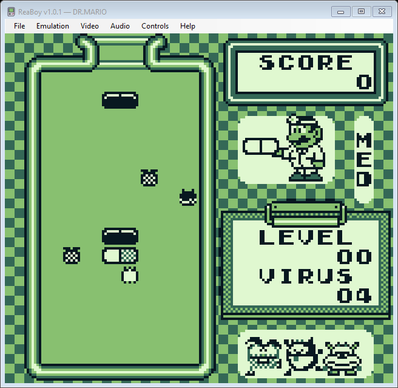
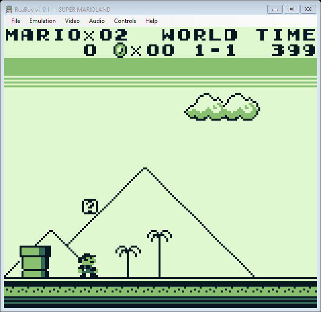

<div align="center">

# ReaBoy

### Game Boy & Game Boy Color games. One clean Windows app.

**Windows x64 · Version 2.0 (Dual DMG + CGB) · BJ Studios, Manchester**

[**Download EXE**](https://github.com/ScientificBrad/ReaBoy/releases/latest/download/ReaBoy.exe) · [**Portable ZIP**](https://github.com/ScientificBrad/ReaBoy/releases/latest/download/ReaBoy-v1.0.1-win-x64.zip) · [**Product website**](https://scientificbrad.github.io/ReaBoy/) · [Releases](https://github.com/ScientificBrad/ReaBoy/releases)

No .NET install required. Licensed open-source Bootix DMG & CGB firmware included.


</div>

## Dual Hardware Architecture: Game Boy &amp; Game Boy Color

ReaBoy runs both original Game Boy (DMG) and Game Boy Color (CGB) titles with machine-cycle SM83 CPU interleaving, a dot-accurate dual Pixel FIFO PPU, and 63 passing hardware test ROMs:

| Hardware Capability | Original Game Boy (DMG) | Game Boy Color (CGB) |
|---|---|---|
| **Hardware Model** | DMG-01 Monochrome (1989) | CGB-001 Dual-Mode &amp; CGB-Only |
| **CPU Frequency** | Sharp SM83 @ 4.194 MHz (1×) | 8.388 MHz (2× KEY1 Speed Switch) |
| **Video &amp; Palettes** | 4-shade monochrome DMG palette | 15-Bit RGB555 (64 Custom Palettes) |
| **Pixel Pipeline** | Dot-accurate scanline PPU | Dot-accurate Pixel FIFO (Acid2 0/23,040 Diff) |
| **Memory Subsystems** | 8 KiB VRAM / 8 KiB WRAM | 16 KiB VRAM / 32 KiB Banked WRAM |
| **DMA Controllers** | 160-M-cycle OAM DMA | HDMA / GDMA (H-Blank &amp; General DMA) |
| **Commercial Game Library** | 1,592 Titles (100% Playable) | Dual &amp; CGB-Exclusive Library |
| **Cartridge Mappers** | ROM-Only, MBC1, MBC2, MBC3 (+RTC) | MBC1, MBC2, MBC3, MBC5, MBC7 (tilt), HuC1/3 |
| **Battery Save Persistence** | Standard `.sav` in `%APPDATA%` | Atomic Saves (Automatic `.sav.bak`) |
| **Automated Hardware Tests** | Blargg &amp; Mooneye-GB suites | 63 / 63 Passing Test ROMs |


## Install in one command

Paste this into **Windows PowerShell**:

```powershell
curl.exe -fsSL https://raw.githubusercontent.com/ScientificBrad/ReaBoy/main/install.ps1 -o "$env:TEMP\ReaBoy-install.ps1"; if ($LASTEXITCODE -eq 0) { powershell.exe -NoProfile -ExecutionPolicy Bypass -File "$env:TEMP\ReaBoy-install.ps1" }
```

The [installer](install.ps1) downloads the latest Windows ZIP, verifies its SHA-256 checksum, installs under **%LOCALAPPDATA%/Programs/ReaBoy**, creates a Start-menu shortcut, and opens the app. No administrator rights are needed. Existing settings, saves and custom boot firmware are preserved.

Prefer a portable copy? Download the ZIP and extract it anywhere. Or download the standalone EXE; its runtime and fallback firmware are embedded.

## New in 1.0.1

- **Dr. Mario freeze fixed:** LCD-off status now reports mode 0, allowing screen changes to complete.
- **Audio stability:** native audio headers stay pinned while the Windows driver owns them.
- **Boot firmware included:** Bootix DMG v1.2 is bundled under CC0-1.0.
- Separate EXE, ZIP, installer and checksum downloads.
- A short boot-up video, fresh screenshots and a dedicated product page.

## Fresh screenshots

| Tetris | Dr. Mario | Super Mario Land |
|---|---|---|
|  |  |  |

These are actual captures from ReaBoy v1.0.1. Games are shown for compatibility demonstration; no commercial game files are included.

[Watch the short boot-up video](docs/assets/boot-preview.mp4) · [Open the product page](https://scientificbrad.github.io/ReaBoy/)

## Start playing

1. Open **ReaBoy.exe**. The bundled firmware lets the app start without a separate firmware download.
2. Choose **File > Open ROM**, or drag in your own Game Boy game.
3. Use **Emulation > Remove Cartridge** to return to the no-cartridge screen, or **Reset** to restart the game.

The normal window stays at the selected display size. Scaling and fullscreen are in the Video menu.

## About the included ROM

**rom/dmg_boot.bin is Bootix DMG v1.2**, an unmodified open-source replacement, **not Nintendo's original firmware**.

- [Upstream Bootix project](https://github.com/Ashiepaws/Bootix)
- [Full CC0-1.0 licence](rom/BOOTIX-LICENSE.txt)
- [Pinned version, commit and SHA-256](rom/BOOTIX-SOURCE.txt)
- [Download the boot ROM](https://github.com/ScientificBrad/ReaBoy/releases/latest/download/dmg_boot.bin)

The same firmware is embedded in the EXE. A valid custom firmware selected through **File > Choose Boot ROM** takes priority, followed by an adjacent **rom/dmg_boot.bin**. If neither exists, the embedded copy is used.

Your existing original Nintendo boot ROM selection remains respected. **File > Skip Intro** skips boot on subsequent resets and game loads.

## Features

- Original monochrome Game Boy hardware target.
- Sharp SM83 CPU, memory bus, PPU graphics and four-channel APU.
- ROM-only and MBC1 cartridges, up to 2 MiB ROM and 32 KiB RAM.
- Battery-backed MBC1 saves.
- File picker, drag and drop and recent games.
- Pause/resume, reset, remove cartridge and 3× fast forward.
- Fixed 1×–4× window sizes, integer scaling and fullscreen.
- Classic green and grayscale palettes.
- Configurable keyboard controls, volume and mute.

## Default controls

| Input | Keys |
|---|---|
| D-pad | Arrow keys or WASD |
| A / B | Z / X or J / K |
| Start / Select | Enter / Shift |
| Pause / Reset | P / R |
| Fullscreen / Mute | F11 / M |
| Open ROM | Ctrl+O |

Settings and saves are kept under **%APPDATA%/BJStudios/ReaBoy/**. Games and firmware remain where you placed them.

## Compatibility

ReaBoy targets monochrome Game Boy games with ROM-only or MBC1 cartridges. Game Boy Color-only titles, MBC3/MBC5, link cable and save states are not supported.

Exact hardware timing and broad game compatibility are not certified. Fast forward targets 3× speed and intentionally mutes sound.

## Downloads and licences

The [latest release](https://github.com/ScientificBrad/ReaBoy/releases/latest) includes **ReaBoy.exe**, a portable ZIP, the PowerShell installer, the licensed boot ROM and **SHA256SUMS.txt**.

Application and third-party terms are in [LICENSES.txt](LICENSES.txt). Bootix keeps its CC0 licence; ReaBoy application source is not published here.

**BJ Studios — Manchester, England**  
© 2026 BJ Studios. All rights reserved.

ReaBoy is independent and not affiliated with Nintendo. Game names, trademarks and game content belong to their respective rights holders.
