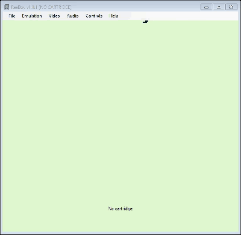
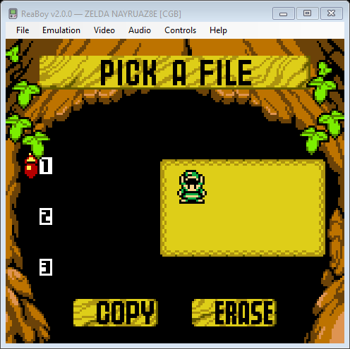
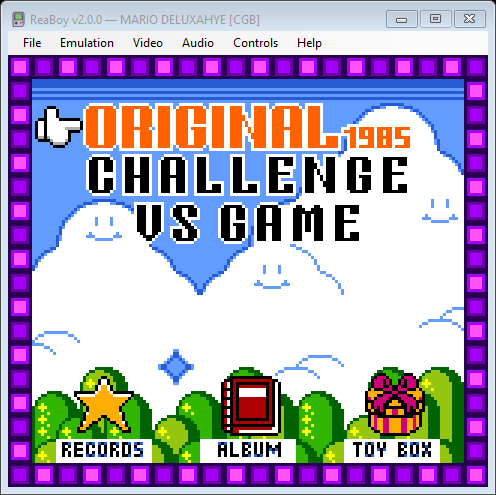
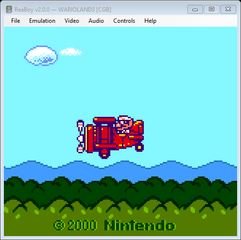
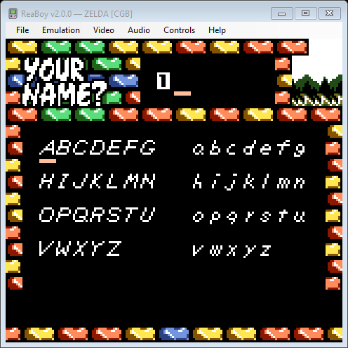
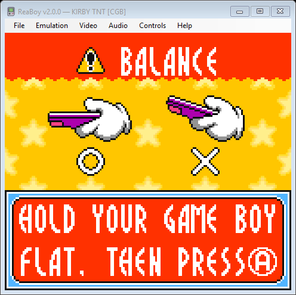
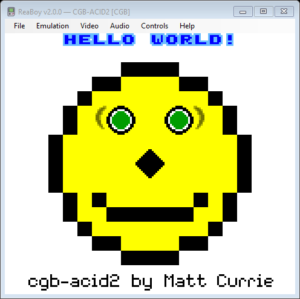
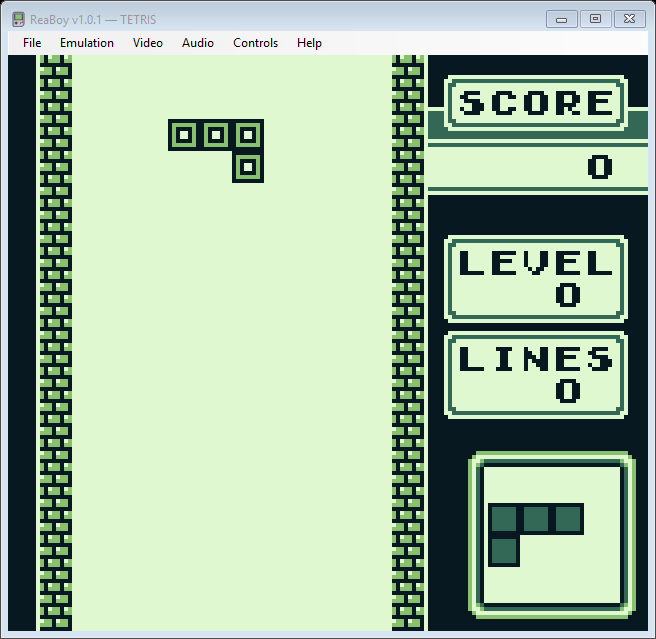

<div align="center">

# ReaBoy v2.0

### Game Boy & Game Boy Color Emulator for Windows

Built in C#/.NET, ReaBoy recreates the original Nintendo Game Boy and Game Boy Color hardware in a unified Windows application.

**Windows x64 · Version 2.0.0 (DMG-01 & CGB-001) · BJ Studios — Manchester, England**

[**Download EXE**](https://github.com/ScientificBrad/ReaBoy/releases/latest/download/ReaBoy.exe) · [**Portable ZIP (v2.0.0)**](https://github.com/ScientificBrad/ReaBoy/releases/latest/download/ReaBoy-v2.0.0-win-x64.zip) · [**Product Website**](https://scientificbrad.github.io/ReaBoy/) · [**All Releases**](https://github.com/ScientificBrad/ReaBoy/releases)

No .NET installation or administrator rights required. Open-source Bootix DMG v1.2 firmware (CC0-1.0) included.



</div>

---

## Unified Game Boy (DMG) & Game Boy Color (CGB) Architecture

ReaBoy v2.0 upgrades the original DMG-01 engine into a unified machine-cycle-accurate Game Boy and Game Boy Color emulator. It automatically identifies the inserted cartridge (`$0143` header flag) or runs in user-selectable **Auto**, **Game Boy Color (CGB)**, or **Original Game Boy (DMG)** hardware modes:

| Hardware Subsystem | Original Game Boy (DMG-01) | Game Boy Color (CGB-001) |
|---|---|---|
| **Operating Modes** | Monochrome DMG (`$00`, `$80`) | Native CGB (`$80`, `$C0`) & CGB-on-DMG Compatibility Mode (`$00`) |
| **CPU Core** | Sharp SM83 @ 4.194304 MHz (1×, M-cycle interleaved) | Sharp SM83 @ 4.194304 MHz (1×) & **8.388608 MHz (2× `KEY1` Double-Speed)** |
| **Pixel Pipeline (PPU)** | Dot-accurate dual Pixel FIFO (`BgFifo` + `ObjFifo`) | Dot-accurate dual Pixel FIFO with CGB tile attributes & `OPRI` priority |
| **Color & Palettes** | 4-shade Classic Olive Green & Grayscale palettes | **15-Bit RGB555** (8 BG + 8 OBJ palettes, 64 colors via `BCPS`/`BCPD`/`OCPS`/`OCPD`) |
| **Video & Work RAM** | 8 KiB VRAM / 8 KiB WRAM | **16 KiB Banked VRAM (`VBK`)** / **32 KiB Banked WRAM (`SVBK`)** |
| **DMA Controllers** | 160-M-cycle cycle-accurate OAM DMA with bus conflict | OAM DMA + **General-Purpose DMA (GDMA)** & **HBlank DMA (HDMA)** |
| **Audio (APU)** | 4-Channel Stereo APU (`DIV`-driven 512 Hz frame sequencer) | 4-Channel Stereo APU + CGB `PCM12` (`$FF76`) & `PCM34` (`$FF77`) digital outputs |
| **Cartridge Controllers** | `ROM-Only`, `MBC1`, `MBC2`, `MBC3` (+RTC) | `ROM-Only`, `MBC1`, `MBC2`, `MBC3`/`MBC30` (+RTC), `MBC5` (8 MiB), `MBC7` (Tilt+EEPROM), `HuC1`, `HuC3` |
| **Serial & Peripherals** | Serial Port (`$FF01`/`$FF02`) & Game Boy Printer (PNG export) | Multi-rate CGB Serial (`256 KiHz` / `512 KiHz`), Virtual Link & Game Boy Printer |
| **Battery Persistence** | SHA-256 isolated `.sav` in `%APPDATA%\BJStudios\ReaBoy\saves` | Atomic `.sav` + `.sav.bak` rotation, 15s auto-save, RTC JSON & 93LC56 EEPROM |
| **Hardware Test Verification** | `dmg-acid2` (0/23,040 diff), Blargg, Mooneye-GB | **188 / 188 Automated Tests & 63 / 63 Hardware Test ROMs Passing** (`cgb-acid2` 0/23,040 diff) |

---

## Install in One Command

Paste this into **Windows PowerShell**:

```powershell
irm https://raw.githubusercontent.com/ScientificBrad/ReaBoy/main/install.ps1 | iex
```

Or using `curl.exe`:

```powershell
curl.exe -fsSL https://raw.githubusercontent.com/ScientificBrad/ReaBoy/main/install.ps1 -o "$env:TEMP\ReaBoy-install.ps1"; if ($LASTEXITCODE -eq 0) { powershell.exe -NoProfile -ExecutionPolicy Bypass -File "$env:TEMP\ReaBoy-install.ps1" }
```

The [installer](install.ps1) downloads `ReaBoy-v2.0.0-win-x64.zip` from the latest GitHub release, verifies its SHA-256 checksum against `SHA256SUMS.txt`, prevents accidental version downgrades, installs under `%LOCALAPPDATA%\Programs\ReaBoy`, creates a Start Menu shortcut, and launches ReaBoy. Existing v1.0 / v1.0.1 settings, `.sav` files, and custom boot ROMs upgrade seamlessly.

Prefer a portable copy? Download [**ReaBoy-v2.0.0-win-x64.zip**](https://github.com/ScientificBrad/ReaBoy/releases/latest/download/ReaBoy-v2.0.0-win-x64.zip) and extract it anywhere, or download the standalone [**ReaBoy.exe**](https://github.com/ScientificBrad/ReaBoy/releases/latest/download/ReaBoy.exe).

---

## What's New in ReaBoy v2.0.0

- **Full Game Boy Color (CGB) Hardware Support:** 2× CPU double-speed (`KEY1`), 16 KiB banked VRAM (`VBK`), 32 KiB banked WRAM (`SVBK`), 64 bytes each of BG and OBJ 15-bit RGB555 color palette RAM (`BCPS`/`BCPD`/`OCPS`/`OCPD`), General-Purpose DMA (GDMA), HBlank DMA (HDMA), and CGB tile attributes (palette index, VRAM bank, horizontal/vertical flip, BG-to-OAM priority).
- **Machine-Cycle CPU & Bus Interleaving:** Every memory read, write, and internal cycle inside `Sm83Cpu` ticks the bus by 1 M-cycle (4 T-cycles), passing all 16 Blargg CPU/Timing/MemTiming/HALT suites and all 37 Mooneye-GB acceptance & MBC2 suites.
- **Dot-Accurate Dual Pixel FIFO PPU:** Separate 8-pixel `BgFifo` and `ObjFifo` shift registers and a 5-step tile fetcher pass both `dmg-acid2.gb` and `cgb-acid2.gbc` with **0 / 23,040 pixel mismatch** against official hardware reference renders.
- **Expanded Cartridge Controllers (`MBC1`–`MBC7`, `HuC1`, `HuC3`):** Adds `MBC2` (512×4-bit nibble RAM), `MBC3`/`MBC30` (hardware Real-Time Clock with wall-clock elapsed advancement), `MBC5` (up to 8 MiB ROM / 128 KiB RAM), `MBC7` (2-axis keyboard tilt accelerometer + 256-byte 93LC56 SPI EEPROM for *Kirby's Tilt 'n' Tumble*), `HuC1` (IR mode), and `HuC3` (RTC command mailbox).
- **Hardware Mode Selection & Validation:** Choose **Auto**, **Game Boy Color (CGB)**, or **Original Game Boy (DMG)** under **Emulation > Hardware Mode**. Dual-mode (`$80`) cartridges run in full color in CGB mode and authentic 4-shade monochrome in DMG mode; CGB-exclusive (`$C0`) cartridges reject DMG mode with a clear compatibility message.
- **Game Boy Printer Emulation:** Toggle **Emulation > Attach Game Boy Printer** to print directly from titles such as *Pokémon Crystal*, *Pokémon Gold*, and *Link's Awakening DX* to PNG files under `%APPDATA%\BJStudios\ReaBoy\Prints\`.

---

## Genuine ReaBoy v2.0 Captures (Game Boy Color & Original Game Boy)

| Zelda: Oracle of Ages (`[CGB]`) | Super Mario Bros. Deluxe (`[CGB]`) | Wario Land 3 (`[CGB]`) |
|---|---|---|
|  |  |  |

| Zelda: Link's Awakening DX (`[CGB]`) | Kirby's Tilt 'n' Tumble (`MBC7` `[CGB]`) | Matt Currie `cgb-acid2` (`0/23,040` Diff) |
|---|---|---|
|  |  |  |

| Tetris (`[DMG]`) | Dr. Mario (`[DMG]`) | Super Mario Land (`[DMG]`) |
|---|---|---|
|  |  |  |

All screenshots are genuine captures from ReaBoy. No commercial game ROMs or proprietary Nintendo boot ROMs are included in the repository or release packages.

---

## Three Supported Cartridge Categories

1. **Category A — Original Game Boy (DMG, `$0143 = $00`):** 1,592 verified monochrome commercial titles (*Tetris*, *Super Mario Land*, *Dr. Mario*, *Kirby's Dream Land*, *Link's Awakening*, *F-1 Race*, *Pokémon Red/Blue*). Runs on authentic DMG-01 hardware (`[DMG]`) in Auto/DMG mode, or in CGB-on-DMG hardware compatibility mode (`[CGB/DMG]`) when CGB mode is selected.
2. **Category B — Game Boy Color Compatible (Dual DMG/CGB, `$0143 = $80`):** Dual-compatible titles (*Tetris DX*, *The Legend of Zelda: Link's Awakening DX*, *Pokémon Gold/Silver*, *Wario Land II*, *Game Boy Gallery 3*). Boots in full 15-bit RGB555 color (`[CGB]`) under Auto/CGB mode, or on 4-shade monochrome DMG-01 hardware (`[DMG]`) when Original Game Boy mode is selected.
3. **Category C — Game Boy Color Exclusive (`$0143 = $C0`):** CGB-only titles (*Pokémon Crystal*, *The Legend of Zelda: Oracle of Ages & Oracle of Seasons*, *Super Mario Bros. Deluxe*, *Wario Land 3*, *Kirby's Tilt 'n' Tumble*, *Pocket Family GB2*). Requires CGB hardware (`[CGB]`).

---

## Default Controls

| Input | Default Keys |
|---|---|
| **D-Pad ( & MBC7 Tilt )** | Arrow keys or `W` `A` `S` `D` (`NumPad 8/2/4/6` also tilts MBC7 accelerometer) |
| **A / B Buttons** | `Z` / `X` or `J` / `K` |
| **Start / Select** | `Enter` / `Shift` or `Space` |
| **Pause / Reset** | `P` / `R` |
| **Fullscreen / Mute** | `F11` (`Esc` to exit) / `M` |
| **Open ROM** | `Ctrl+O` or Drag & Drop `.gb` / `.gbc` file |

Settings, battery saves, and printer PNG exports are stored under `%APPDATA%\BJStudios\ReaBoy\`.

---

## Boot Firmware & Open-Source Provenance

- **`rom/dmg_boot.bin` is Bootix DMG v1.2** ([upstream](https://github.com/Ashiepaws/Bootix)), an unmodified CC0-1.0 open-source replacement boot ROM embedded in `ReaBoy.exe` and included in `rom/` with its [license](rom/BOOTIX-LICENSE.txt) and [provenance](rom/BOOTIX-SOURCE.txt).
- You can optionally select your own 256-byte DMG (`dmg_boot.bin`) or 2,304/2,048-byte CGB (`cgb_boot.bin`) boot ROM via **File > Choose Boot ROM…**. When no CGB boot ROM file is configured, CGB cartridges initialize directly at `$0100` with hardware-exact post-boot registers (`AF=$1180`, `BC=$0000`, `DE=$FF56`, `HL=$000D`, `SP=$FFFE`) and CGB palette state.

---

## Official v2.0.0 SHA-256 Checksums (`SHA256SUMS.txt`)

```text
20cbad0749e856c5230b924ccc77c4016a98cb9c05e9f149d893c7182ad98d85  ReaBoy-v2.0.0-win-x64.zip
ee7c6d4fc350eeab29f66d7197ac631d0fa37b9f162e78acdd718ffc09beca99  ReaBoy.exe
c313435280dda8ccfae0786c7159aab791a00930605101c647794f64bfa17b5e  dmg_boot.bin
014c49cff8a92aa7d0db0a7fa69de0ef84b3a775e64a71b9ff403e0098996c25  install.ps1
```

Application and bundled runtime notices are in [LICENSES.txt](LICENSES.txt).

**BJ Studios — Manchester, England**  
© 2026 BJ Studios. All rights reserved.

ReaBoy is an independent emulator and is not affiliated with or endorsed by Nintendo. Game names, trademarks, and game content belong to their respective rights holders.
