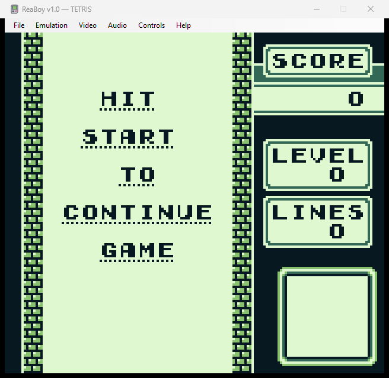
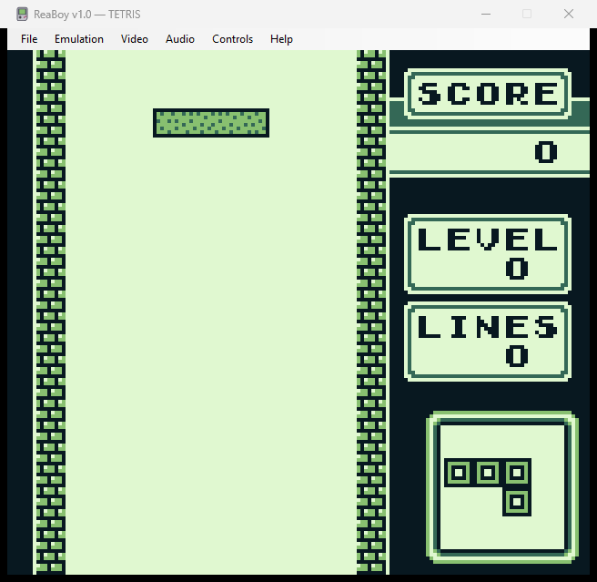

# ReaBoy

**A standalone Game Boy emulator for Windows, by BJ Studios.**  
Built in Manchester, England.

[Download ReaBoy v1.0 for Windows x64](https://github.com/ScientificBrad/ReaBoy/releases/latest/download/ReaBoy-v1.0-win-x64.zip) · [All releases](https://github.com/ScientificBrad/ReaBoy/releases)

ReaBoy brings the original monochrome Game Boy to a compact Windows application, with crisp pixel scaling, four-channel sound and a familiar boot intro.

## Screenshots

### Tetris — gameplay

### Tetris — pause screen

Tetris is shown to demonstrate compatibility. No game files are included.

## Get started

1. Download the Windows ZIP from Releases and extract it.
2. For the original boot intro, place your own **256-byte DMG boot ROM** in **rom/dmg_boot.bin**, beside ReaBoy.exe.
3. Open **ReaBoy.exe**. It starts on the Nintendo logo / no-cartridge screen.
4. Use **File > Open ROM** to choose your own Game Boy game, or drag a game onto the window.

No separate .NET installation is required. Windows x64 only.

The folder layout after extraction is:

| File or folder | Purpose |
|---|---|
| ReaBoy.exe | Application and bundled runtime |
| README.md | User guide, controls and version details |
| LICENSES.txt | Application copyright and runtime notices |
| rom/dmg_boot.bin | Your own boot firmware; not supplied |
| rom/ | Optional location for your own game ROMs |

ReaBoy automatically finds the adjacent boot ROM when no valid custom boot path is configured.
You can also choose firmware with **File > Choose Boot ROM**.
**File > Skip Intro** skips the firmware intro on subsequent resets and game loads.
The adjacent rom folder is the default game-file location when no previous directory is available.

**Nintendo boot firmware and commercial game ROMs are not included.**
Availability on an archive website does not grant a redistribution licence.
Use firmware and games you have the right to use.

## Features

- Original monochrome Game Boy hardware target.
- Sharp SM83 CPU emulation, memory bus, PPU graphics and four-channel APU.
- ROM-only and MBC1 cartridge support, up to 2 MiB ROM and 32 KiB RAM.
- Battery-backed MBC1 saves.
- Open-file dialog, drag and drop, and recent games.
- Pause/resume, reset, remove cartridge and 3x fast forward.
- Fixed 1x–4x window scales, fullscreen and integer scaling.
- Classic green and grayscale display palettes.
- Sound enable/mute, volume and configurable keyboard controls.
- Persistent settings and an About dialog.

The app starts automatically. **Remove Cartridge** returns to the empty-console logo screen; **Reset** restarts the selected game.
The normal window stays at the chosen display size.

## Default controls

| Game Boy input | Keyboard |
|---|---|
| D-pad | Arrow keys or WASD |
| A | Z or J |
| B | X or K |
| Start | Enter |
| Select | Shift or Space |

| App command | Key |
|---|---|
| Open ROM | Ctrl+O |
| Pause/resume | P |
| Reset | R |
| Mute/unmute | M |
| Fullscreen | F11 |
| Leave fullscreen | Escape |

## Settings and saves

Settings and battery RAM are kept under **%APPDATA%/BJStudios/ReaBoy/**.
The app saves battery RAM when changing or resetting games, removing a cartridge, or exiting.
Your games and firmware remain where you placed them.

## Compatibility

Tetris is the primary integration test. This is the first release; broad game compatibility and exact hardware timing are not certified.

Game Boy Color-only games, MBC3, MBC5, link cable and save states are not supported.
Fast forward targets 3x speed and intentionally mutes sound.

## About

**ReaBoy v1.0**  
Product version 1.0.0 · Windows x64 · C# / .NET 8  
**BJ Studios — Manchester, England**  
© 2026 BJ Studios. All rights reserved.

This repository hosts ReaBoy downloads, screenshots and user documentation.
Application and runtime terms are in [LICENSES.txt](LICENSES.txt).

ReaBoy is independent and is not affiliated with or endorsed by Nintendo.
Nintendo, Game Boy and Tetris names, trademarks and game content belong to their respective rights holders.
